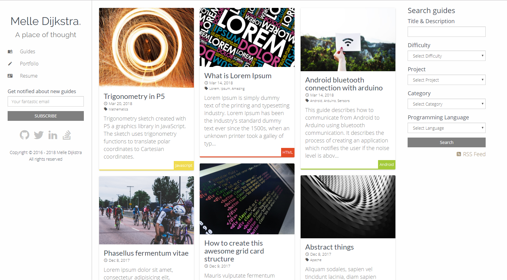
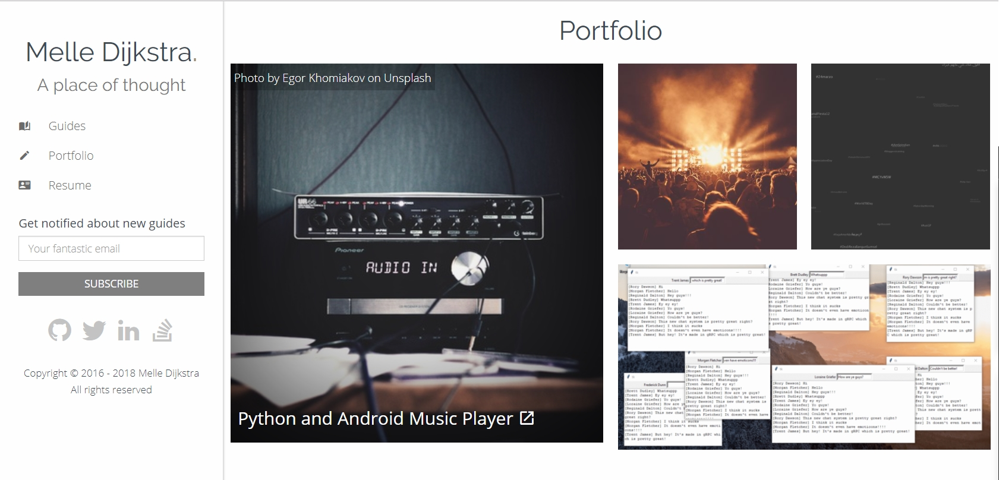
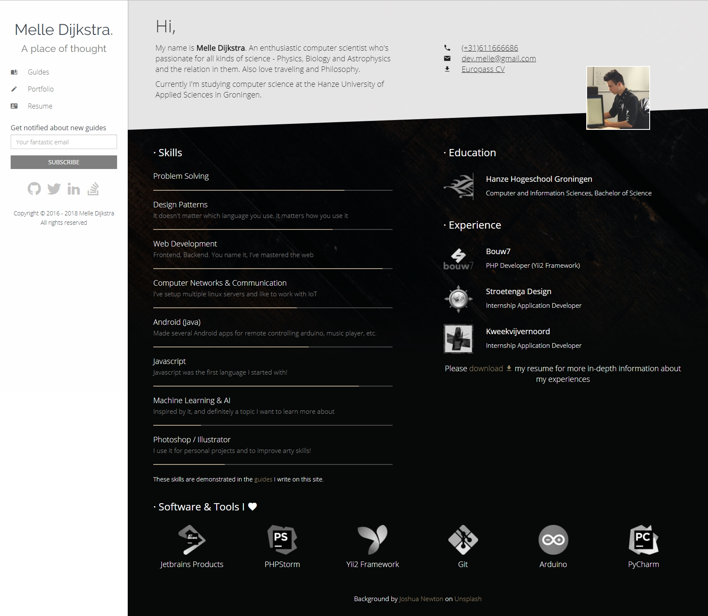

# Melle Dijkstra's personal website

This repository contains the official source code used for my personal website
Copyright © 2016 - 2026 Melle Dijkstra, All rights reserved

## Installation

### Unix based systems

reference: https://docs.github.com/en/pages/setting-up-a-github-pages-site-with-jekyll

Open the terminal.

Check whether you have Ruby 3.4 or higher installed:

```
$ ruby --version
> ruby 3.4.X
```

If you don't have Ruby installed, install Ruby 3.4 or higher.

Install Bundler:

```
# Installs the Bundler gem
$ gem install bundler
```

Install dependencies (gems):
```
# install all needed gems
$ bundle install
```

## Impression

Stories overview page where I display my latest written stories/articles.
It uses a [masonry layout](https://masonry.desandro.com/), which is a javascript library
that places the elements in optimal position based on available vertical space. 



Portfolio page



Resume page


